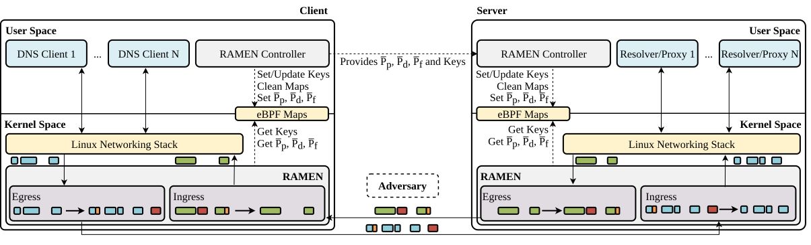

# RAMEN

RAMEN is a defense against website fingerprinting on encrypted DNS. It runs in the Linux kernel as an eBPF program and does not require changes to applications.

DNS encryption protects the content of queries, but not the size and timing of the packets that carry them, and a classifier trained on these features can identify the website a client is visiting. RAMEN pads packets, splits them into fragments and injects dummy packets, with probabilities that change at every DNS resolution, so that repeated visits to the same website produce different traffic. The receiving host removes padding and dummy packets before they reach the application.

This repository contains the code for the paper *Defending against Website Fingerprinting on Encrypted DNS with RAMEN*, currently under review. Citation information will be added once the paper is published.

## Architecture



RAMEN runs on both the client and the server that hosts the protected service, for example a DNS resolver. On each host, an eBPF program applies the countermeasures to outgoing packets and reverses them on incoming ones, and a user-space controller loads it and manages the keys.

| Directory | Content |
|---|---|
| `eBPF/kernel` | the eBPF datapath, in C |
| `eBPF/user` | the Rust library that loads the datapath and manages its maps |
| `client` | the client controller, a daemon that is also its own command-line tool |
| `server` | the server controller, which receives the clients' keys over HTTPS |
| `experiment` | the programs and scripts used to measure latency in the paper |

## Requirements

RAMEN is a research prototype. It needs a Linux kernel with eBPF and BTF support, network offloads (GRO, GSO, TSO and checksum offload) disabled on the interface, and a standard MTU of 1500 bytes.

On both hosts, install the dependencies and disable the offloads. The second script must be run again after every reboot.

```bash
sudo ./install-dependencies.sh
sudo ./disable-offloads.sh <iface>
```

## Running RAMEN

### Server

```bash
cd server
cargo build --release
openssl req -x509 -newkey rsa:2048 -nodes -keyout key.pem -out cert.pem \
    -days 365 -subj "/CN=<server-ip>"
```

In `Rocket.toml`, set `iface` to the network interface and `certs` and `key` to the certificate just generated. Then start the server from the same directory:

```bash
sudo ./target/release/server
```

### Client

```bash
cd client
cargo build --release
sudo mkdir -p /etc/ramen
sudo cp config.yaml /etc/ramen/config.yaml
```

Edit `/etc/ramen/config.yaml`; the comments in the file describe each field. At a minimum, set `interface` and, for each server, `server_ip` and `service_port`. The `name` of each server is the one used in the commands below. Then start the daemon:

```bash
sudo ./target/release/client
```

While the daemon runs, the same binary controls it:

```bash
sudo ./target/release/client status
sudo ./target/release/client list
sudo ./target/release/client update-probs <name> <pad_min> <pad_max> <dummy_min> <dummy_max> <frag_min> <frag_max>
sudo ./target/release/client renew <name>
```

If the server restarts, run `renew` so that it receives the keys again. To install the daemon as a systemd service, use `client/install-service.sh`.

To remove the datapath from an interface:

```bash
sudo tc qdisc del dev <iface> clsact
```

## Latency experiments

`experiment` contains the clients and servers used to measure the latency added by RAMEN. On the server, `start_servers.sh` starts the test servers, two behind RAMEN (ports 8080 and 8081) and two without it (8082 and 8083). On the client, add the defended ports to `/etc/ramen/config.yaml`, start the daemon and run `run_probability_tests.sh`. It measures each combination of countermeasure probabilities and the undefended baseline, and writes the results as CSV files in `results/`.

Build the test programs with `cargo build --release` in `experiment/server` and `experiment/client`. Paths, addresses and the number of rounds are set at the top of each script.

## License

RAMEN is released under the MIT License. See [LICENSE](LICENSE).